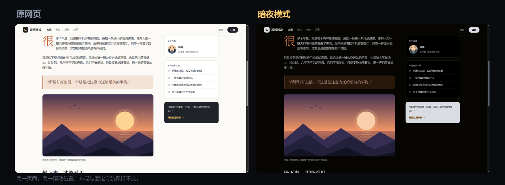
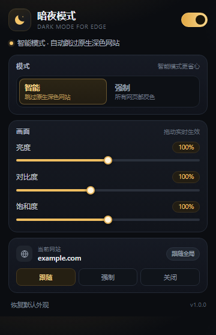

# 暗夜模式 · Edge 护眼

一个轻量的 Microsoft Edge 深色模式扩展。它会给网页加一层柔和的“暗房滤镜”，让原本刺眼的白色页面变成深色，同时尽量保留图片、视频、品牌色和页面布局。



## 功能

- **所有网页一键变暗**：普通文章、后台系统、搜索结果、文档页面都可以使用。
- **智能跳过原生深色网站**：先检测页面底色，已经是深色的网站不会被二次反色。
- **固定导航不位移**：使用覆盖式滤镜，而不是给 `html` 加 `filter`，吸顶导航、固定侧栏和弹层不会跑位。
- **图片和视频保持原色**：对图片、视频做二次反色，照片不会变成负片。
- **iframe 单独协调**：原生深色的播放器保持深色，浅色嵌入表单会被单独压暗，图片仍然正常。
- **亮度 / 对比度 / 饱和度**：三档滑杆实时调节，设置自动保存在本机。
- **按站点开关**：任何网站都可以单独设为「跟随 / 强制 / 关闭」。
- **快捷键**：`Alt + Shift + D` 在当前网站快速开关。



## 安装

1. 把仓库或压缩包解压到一个固定文件夹，确认文件夹里直接能看到 `manifest.json`。
2. 在 Edge 地址栏打开 `edge://extensions`。
3. 打开左下角的 **开发人员模式**。
4. 点击 **加载解压缩的扩展**，选择这个文件夹。
5. 在工具栏的拼图图标里把「暗夜模式」固定出来。

> Edge 可能会提示“关闭开发人员模式扩展”。这是所有未上架扩展都会出现的提示，选择保留即可。  
> 如果希望对本地 `file://` 页面生效，需要在扩展详情页打开 **允许访问文件 URL**。

## 使用

点击工具栏图标打开设置：

- **总开关**：临时暂停 / 恢复整个扩展。
- **智能模式**：自动识别页面底色，原生深色网站保持原样（推荐）。
- **强制模式**：所有页面都套用反色滤镜。注意：原生深色网站也会被反色，可能反而变亮。
- **画面**：亮度、对比度、饱和度，拖动即时生效。
- **当前网站**：
  - `跟随`：使用上面的全局模式。
  - `强制`：这个网站始终套用滤镜。
  - `关闭`：这个网站保持原样。

设置保存在浏览器本机（`chrome.storage.local`），不会上传。

### 快捷键

| 快捷键 | 作用 |
| --- | --- |
| `Alt + Shift + D` | 当前网站：关闭 / 强制开启 之间切换 |

如果快捷键被其他扩展占用，可以在 `edge://extensions/shortcuts` 里修改。

## 它是怎么工作的

普通“暗色扩展”通常直接给 `html` 加：

```css
html { filter: invert(1) hue-rotate(180deg); }
```

这样确实能让白色变黑，但 `filter` 会给页面创建一个新的包含块，导致 `position: fixed` 的导航栏跟着页面滚动，很多网站会错位。

这个扩展改为在视口上覆盖一层透明的 `backdrop-filter`：

```css
html[data-edm-dark="1"]::before {
  content: "";
  position: fixed;
  inset: 0;
  pointer-events: none;
  backdrop-filter: invert(1) hue-rotate(180deg) ...;
}
```

它只改变“透过这层玻璃看到的东西”，不参与页面布局，所以固定导航、吸顶栏和弹层都保持原位置。图片和视频再反色一次，抵消覆盖层的反色。

iframe 会通过 `postMessage` 和父页面同步“当前已经被反色几次”，据此决定自己是补一层反色、抵消父级反色，还是只给图片补反色，避免嵌入内容出现负片或整块变亮。

## 已知限制

CSS 滤镜不是真正的主题重写，以下情况可能不完美：

- 用 CSS `background-image` 设置的**背景照片**会被整体反色，可能看起来偏色。正文里的 `` 图片不受影响。
- 彩色 emoji、部分图标字体可能出现轻微色相变化。
- Canvas / WebGL 应用、地图、复杂可视化界面可能颜色不自然。
- 浏览器内部页面（`edge://`、扩展商店）无法注入。
- 浅色 iframe 在父页面反色时会隐藏自己的滚动条，避免出现一条刺眼的白边；仍然可以用滚轮滚动。
- 强制模式会让原生深色网站也反色变亮，日常建议使用智能模式。

遇到不适配的网站，点扩展图标把「当前网站」设为 **关闭** 即可，不影响其他网站。

## 权限与隐私

| 权限 | 用途 |
| --- | --- |
| `storage` | 保存亮度、模式、站点规则等设置 |
| `activeTab` | 在弹窗里显示当前网站域名 |
| `<all_urls>` | 把深色样式注入网页（扩展的核心功能） |

扩展不发起网络请求，不收集、不上传任何浏览数据，也没有任何分析统计。

## 目录结构

```text
edge-dark-mode/
├─ manifest.json          # Manifest V3 配置
├─ src/
│  ├─ content.js          # 页面检测、滤镜开关、iframe 协调
│  ├─ content.css         # 覆盖层与图片反色规则
│  ├─ background.js       # 快捷键
│  ├─ popup.html          # 设置弹窗
│  ├─ popup.css
│  └─ popup.js
├─ icons/                 # 16 / 32 / 48 / 128 / 256 图标
├─ screenshots/           # 说明文档配图
├─ test/                  # 本地测试页面
└─ tools/make_assets.py   # 图标与测试图片生成脚本
```

## 开发与测试

修改代码后，在 `edge://extensions` 里点击扩展卡片上的 **重新加载**，再刷新目标网页。

本地测试页（需要先启动一个静态服务器）：

```powershell
cd edge-dark-mode
python -m http.server 8765
```

然后打开：

- `http://127.0.0.1:8765/test/light.html`：浅色长文章，含固定导航和照片
- `http://127.0.0.1:8765/test/dark.html`：原生深色页面，用来自动跳过
- `http://127.0.0.1:8765/test/media.html`：图片、头像、图标、色块
- `http://127.0.0.1:8765/test/frames.html`：浅色父页面 + 深色/浅色 iframe
- `http://127.0.0.1:8765/test/frames-dark.html`：深色父页面 + 浅色 iframe

重新生成图标和测试图片：

```powershell
python tools/make_assets.py
```

## 打包

把 `manifest.json`、`src/`、`icons/`、`screenshots/` 和 `README.md` 放在压缩包根目录即可。`test/`、`tools/`、`qa/` 不参与打包。

## 版本

`1.0.0`
